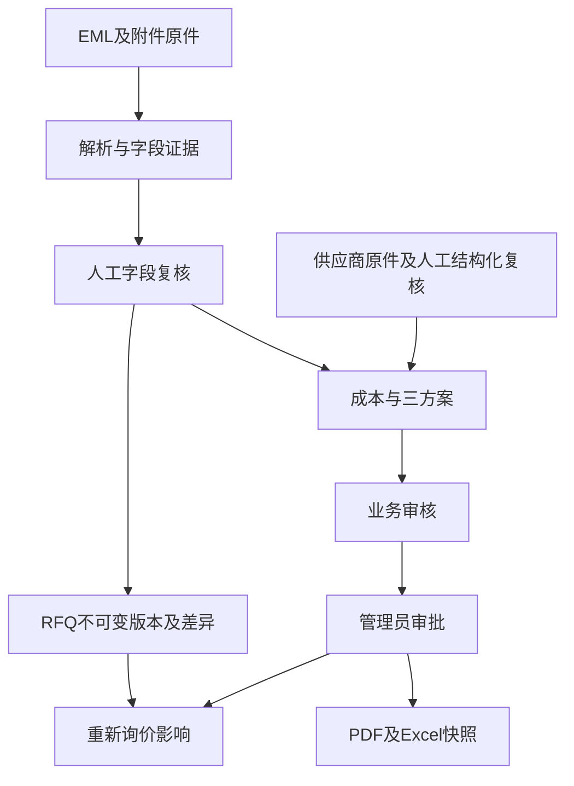

# QuotePilot 当前商业闭环架构

FastAPI负责权限、上传限制与状态校验；浏览器页面不持有API Key。SQLite保存现有数据、原件BLOB、字段证据、版本、报价与追加审计。SQLGlot结构校验+只读SQLite连接为现有自然语言查询提供隔离的SELECT执行路径；新增supplier_offer_catalog/commercial_quote_items只读投影复用该路径。

Genesis负责现有可选模型能力，MOI/MatrixOne适配器及镜像/工作流代码保留。外部搜索经可替换服务适配；配置缺失或provider_unavailable如实显示失败。本轮商业成本/版本差异是本地确定性逻辑，不是MOI原生Snapshot或Branch。

角色为两个共享账户：reviewer负责需求/供应商复核和业务审核，admin负责最终审批及管理指标。签名会话和同账户禁止自批已测试，个人SSO和租户隔离未实现。审计链与不可变触发器只能约束应用和普通SQL修改，文件系统管理员仍可替换整个SQLite；无外部可信时间戳锚点。

商业价值假设：减少重复核对、保留修改影响、让成本与审批可复核。尚无真实客户效率或ROI测量，不把合成成功率外推为业务准确率。
