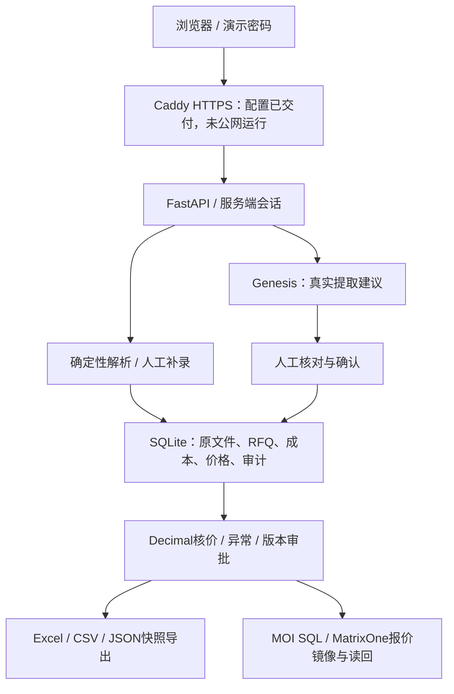
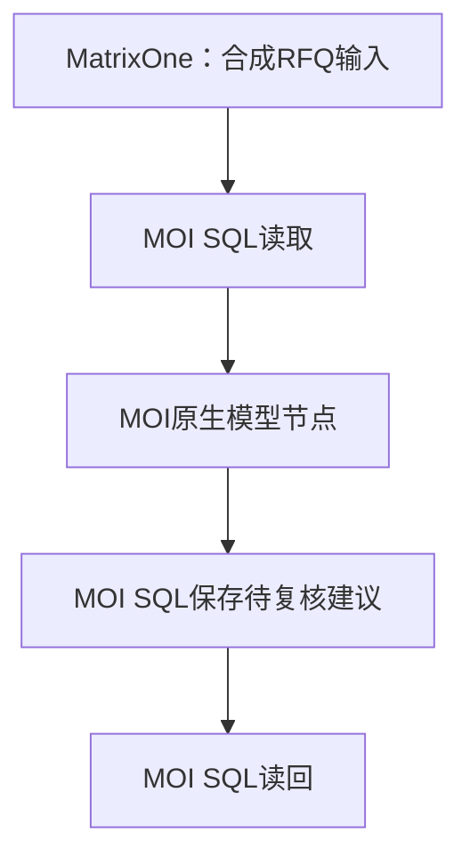

# v0.7 实际架构与部署边界

这是一个实际运行的Python应用，前端由同一服务提供。原邮件与附件以BLOB保存在SQLite，保留SHA256；生产数据卷只包含数据库及备份，不随镜像覆盖。价格与业务计算不由模型完成。模型证据必须存在于提交的原文中，语义正确性仍依靠人工核对。

生产API和文件下载要求服务端签名会话；Genesis个人令牌和会话密钥仅在服务器内存与受控挂载秘密中。一个共享团队演示库不等于企业SSO、RBAC或多租户。

## 原生工作流：已创建定义，执行未通过

该图描述保存的真实DSL，不能用图代替运行证据。实际定义ID为45e246b6-9a6f-5331-82cd-44c00f67cb18，平台返回disabled；版本0且无workflow_def_id/version_id。启动与恢复接口HTTP400，未产生execution_id；工作区可见计算实例列表为空。故后三个节点尚无真实运行结果。没有自动新购或创建计算资源。

云端原生RFQ输入表与报价镜像是不同数据：`rfq_workflow_runs_v1`保存合成输入和待复核建议；`quote_snapshots_v1`保存已确认报价的完整快照。即使云端输入写入成功，也不能将workflow_model未执行说成平台提取已通过。
