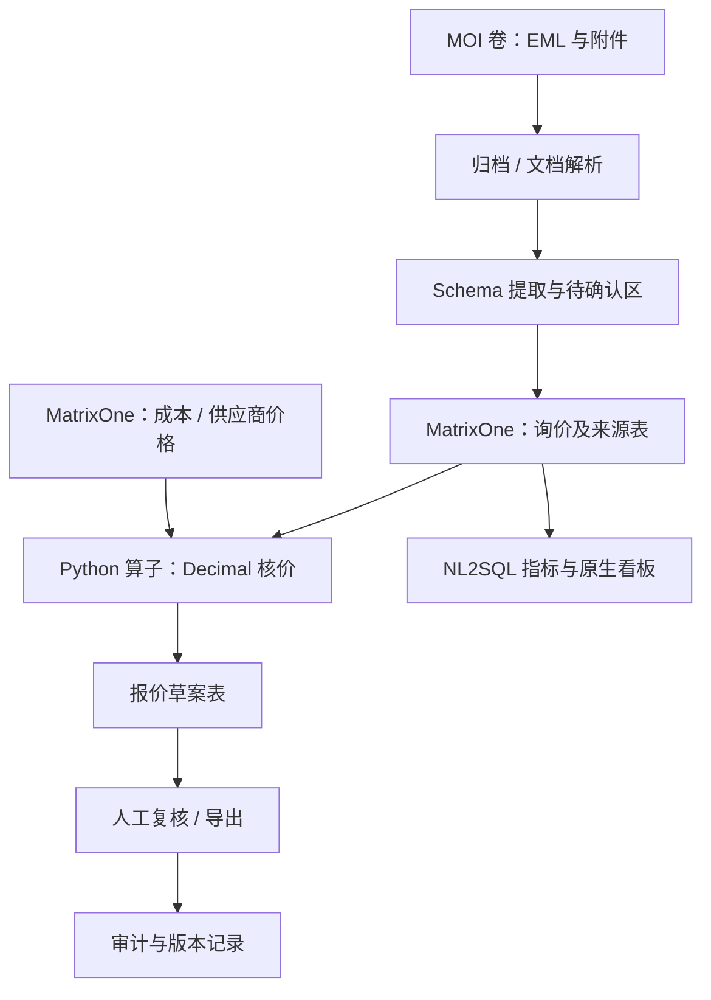

> 历史版本记录：以下结论对应 v0.5 / v0.5.1。v0.6 已新增真实 Genesis 与 MOI SQL 报价快照接入，当前状态请先看 [LIVE_INTEGRATION_20261105.md](LIVE_INTEGRATION_20261105.md)。历史记录中的“未连接”不能代替最新结果。

# MOI-first 接入记录 · 2026-11-04

本地版已运行；以下官方能力经文档核对，**没有任何云端能力被实测或接入**。Genesis 凭据和 AI Studio 工作区凭据是两套服务，不能互用。没有创建云端资源、触发收费调用或发布作品。

## 能力核实矩阵

| 能力 | 官方明确支持 | 权限 / 版本条件 | 实测状态 | QuotePilot 接法 | 当前预留 |
|---|---|---|---|---|---|
| AI Studio 工作流 | 是，创建编排、分支、调试与作业管理 | 参考 MOI 5.0；需目标工作区权限、可用计算资源 | 未实测 | 来件接入 → 解析 → 核价算子 → 入表 → 复核 | `integration/moi_operator.py` 输入输出契约 |
| 邮件归档解析 | 是，邮件路径、头部、正文、收件人、引用邮件；rows/catalog_files 两模式 | Catalog 来源与工作流权限；单封大小上限 | 未实测；文档**未证明可直接拆出附件字节** | 用平台归档解析；附件保留本地 MIME 算子或经平台实际验证的能力 | `parse_eml` 可包装为算子；不猜附件 API |
| 文档解析 | 是，files → documents；原生/标准/增强档位 | 需 Catalog 文件、解析服务；增强档位依赖环境资源 | 未实测 | PDF 用文档解析；复杂扫描件进入增强与 OCR；逐页抽查 | 本地文本 PDF 模板解析；无 OCR 冒充 |
| 信息提取 | 是，JSON Schema、n_to_1/n_to_n、sources_tracking | 需模型和工作流配置；失败来源应独立处理 | 未实测 | 非规则可提取字段走模型建议 → 人工确认 → 正式业务表 | `providers.py`、`extraction_schema.json`；不会自动写入 |
| Python 自定义算子 | 是，普通工作流签名 `handle(workspace_id, sdk, input)` | **管理员须启用 Python 自定义算子执行服务**；依赖、网络、超时由服务端控制 | 签名及本地契约测试通过；云端未实测 | 同一套 Decimal 核价逻辑部署为算子；上游 MOI 表节点提供成本和供应商行 | `integration/moi_operator.py`；须部署 quotepilot 包及依赖 |
| MatrixOne / MOI 表 | 是，存储结构化数据；“存至 MOI 表”节点 | 工作区、Catalog、建表/读写权限、数据库资源 | 未实测 | 询价、成本、价格、报价、审计存表；原文件存卷，表内存实际 Catalog file_id | `matrixone_schema.sql` 迁移设计、`export_matrixone.py` CSV 与文件清单 |
| 自然语言查询 | 是，结构化知识库与 NL2SQL 指标、筛选口径 | 须先有可用结构化表、语义配置、智能体权限 | 未实测 | 定义 RFQ No 分组、明细数、件号数，绑定只读工具；模型不能直接执行写 SQL | 本地白名单四类规则查询，显示 SQL |
| 可视化 | 是，SQL 工作簿、看板、图表生成与运行 | 工作区凭据、对象 ID、图表权限；运行后还需取结果核验 | 未实测 | 原生看板读相同业务表；图表与表格一致 | 当前前端直接画实际 SQL 结果 |
| Genesis | 是，Chat Completions；官方说明可用 OpenAI SDK | Genesis 个人令牌或有 Genesis 权限的服务账号 Key；可调用模型 ID | HTTP MockTransport 契约测试通过；**真实网络调用未验证** | 后端配置环境变量后调用已核实 `/v1/chat/completions` | `GenesisProvider`；结构校验、原文证据检查、失败不落库 |
| Agent 构建与访问 | 是，智能体配置、绑定知识库/工作流/工具、会话调用 | 工作区、运行环境和访问策略；评委匿名/公开访问方式需账户内核实 | 未实测；公开发布权限与 URL 未确认 | Agent 工具绑定只读分析、解析建议、核价工作流；最终审批仍显式人工动作 | 业务 API、算子和 Schema 已准备；没有虚构发布 SDK |

版本说明：以上依据 5.0 在线文档，不能据此推断所有租户已开通，也没有可靠证据确定各能力的最低版本或套餐。

## 平台目标架构（设计，非已完成部署）



实际本地架构：浏览器 → FastAPI → 解析/核价/版本服务 → SQLite（原始二进制、字段快照、业务表、审计）。独立版本保障离线验收，尚不能称为平台原生实现。

## Genesis 配置

官方接入页：[OpenAI SDK 调用](https://docs.matrixorigin.cn/moi/zh/5.0/developer/quickstart/genesis/openai-sdk.html)。本代码使用相同 Chat Completions HTTP 契约，通过现有 httpx 发送请求，不额外引入 SDK。

```bash
export QUOTEPILOT_PROVIDER=genesis
export GENESIS_BASE_URL=https://token.moi.matrixorigin.cn/v1
export GENESIS_ACCESS_TOKEN='在本地填写，勿提交'
export GENESIS_MODEL_ID='从模型广场复制实际 ID'
```

Windows PowerShell 对应使用 `$env:变量名="值"`。`.env.example` 只是模板，不会自动加载。重启服务器后，在 `/api/docs` 调用 `POST /api/extraction/preview`，传 `{"text":"询价原文"}`。这是**显式请求才调用**的建议接口；不在默认离线闭环中偷偷消耗额度。Mock 默认返回空建议并明确 `simulated:true`。Genesis 输出须符合结构 Schema，evidence 必须存在于输入中；这些检查不能证明语义正确，仍需人工确认。当前未提供“一键将模型建议入库”的功能。

UI 默认标记离线，是对主要工作流的真实描述。即便配置 Genesis，主流程仍走本地确定性解析；平台页也不自动变为“已接入”。

## MatrixOne 迁移步骤

1. 在隔离测试库审核 `integration/matrixone_schema.sql`，验证 JSON、Decimal、主键、索引、权限及目标版本方言。此 SQL 目前仅设计，未在 MatrixOne 执行。
2. 本地执行 `python scripts/export_matrixone.py`，生成 `workspace/matrixone_export`：业务 CSV、原文件二进制与 SHA256 清单。
3. 检查数值列，空/异常数值进入待确认表；CSV 空值映射为 NULL，不能把空字符串隐式转 0。按依赖顺序导入，比较行数、主键、总金额和抽样字段。
4. 将原文件上传 MOI 卷，在 manifest 里填**实际返回**的 Catalog file_id，再写 source_files。SQLite BLOB 不直接塞进 MatrixOne JSON。
5. 当前 FastAPI 的存储查询仍为 SQLite；**没有实现可切换 MatrixOneRepository**。用 MOI 工作流作为主执行面，或后续实现数据访问层后才可切库；改个连接字符串不等于迁移完成。
6. 算子读写模式：读取 MOI 表节点 → input.lines / costs / prices → 核价 Python 算子 → 保存表节点。`moi_operator.py` 只使用标准库 SQLite 在算子内构造临时候选表，不调用猜测的 SDK 方法。平台端是否允许所需依赖须现场检查。
7. 验证同一官方数据得到相同报价和异常状态，核对合计；保存工作流 job_id、SQL COUNT、日志与来源截图作为平台证据。
8. 最后绑定 Agent、只读分析工具、审批动作及访问策略；使用未登录浏览器验证评委访问，取得可运行 URL 后才更新接入状态。

## 官方资料

- [赛事官网](https://matrixorigin.cn/matrixnext)：外部开发工具调用 Genesis 可行，推荐使用平台数据与智能体能力；材料 PDF 原生搭建措辞更严格，最终要求仍需主办方确认。
- [平台概览](https://docs.matrixorigin.cn/moi/zh/5.0/get-started/welcome.html)
- [开发服务与凭据区分](https://docs.matrixorigin.cn/moi/zh/5.0/developer/overview/index.html)
- [邮件归档解析](https://docs.matrixorigin.cn/moi/zh/5.0/guides/ai-studio/processing/workflow/nodes/other/email-archive-parse.html)
- [文档解析](https://docs.matrixorigin.cn/moi/zh/5.0/guides/ai-studio/processing/workflow/nodes/ai-processing/document-parse.html)
- [信息提取](https://docs.matrixorigin.cn/moi/zh/5.0/guides/ai-studio/processing/workflow/nodes/ai-processing/information-extraction.html)
- [Python 自定义算子](https://docs.matrixorigin.cn/moi/zh/5.0/guides/ai-studio/processing/workflow/nodes/code-processing/python-processing.html)
- [存至 MOI 表](https://docs.matrixorigin.cn/moi/zh/5.0/guides/ai-studio/processing/workflow/nodes/data-io/save-table.html)
- [NL2SQL 指标](https://docs.matrixorigin.cn/moi/zh/5.0/guides/ai-studio/agents/knowledge-bases/nl2sql-metrics.html)
- [SQL 看板](https://docs.matrixorigin.cn/moi/zh/5.0/developer/api/ai-studio/data-processing/sql-workbooks-dashboards.html)
- [智能体 API](https://docs.matrixorigin.cn/moi/zh/5.0/developer/api/ai-studio/agents/agent-builder.html)

原始《DataAI开发者大会_智能应用开发赛题详细说明.pdf》已阅读，RFQ 部分 p.9–12，平台与提交约束 p.1–2；本交付沿用 v0.4 模块与界面，修复业务约束与持久化，未推倒重写。
