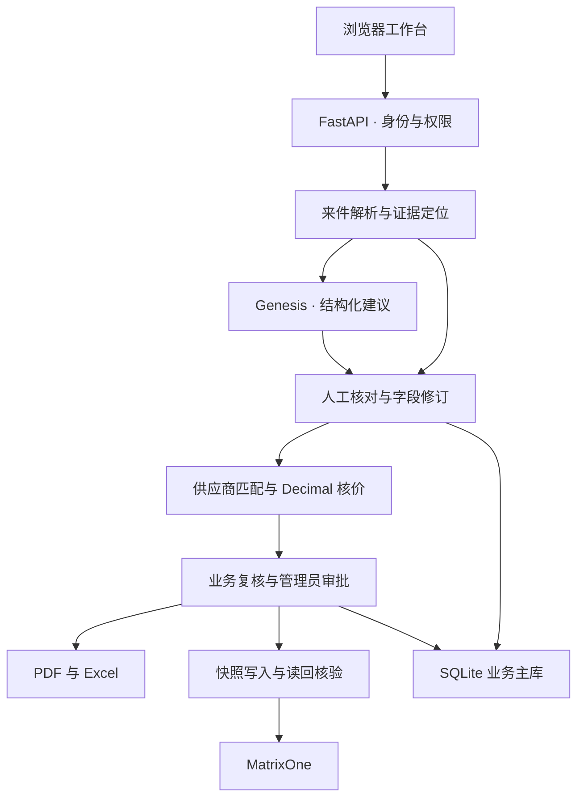
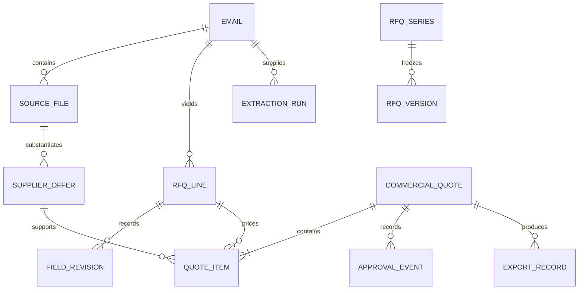
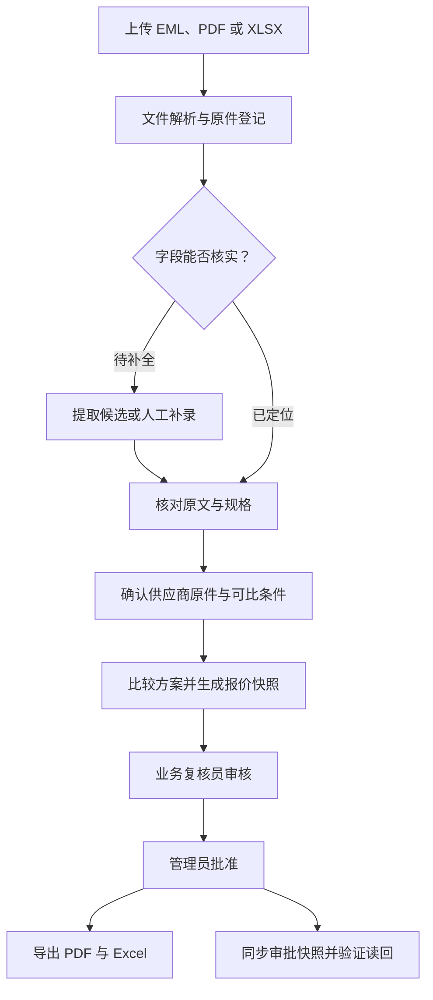

# QuotePilot 报价室

**企业采购 RFQ 询价分析与报价智能体 · MatrixNEXT 2026 命题赛道**

## 公网报价验收 · 2026 年 11 月 10 日

独立 Render 服务在合成订单上完成整笔报价。管理员上传三件阀件的询价，MOI v3 读取原文、调用 Genesis、写入候选并读回。业务复核员逐项核对原件并确认三家供应商报价，从三个方案中选择最低成本方案。另一账户完成审批。每件采购价 10 元，加工成本共 3 元，其他费用共 2 元。成本合计 **35.00 元**，三件正式报价 **43.74 元**。

| 评委可核对的记录 | 本笔公网交易 |
|---|---|
| 原生执行 | `61191015-edc2-4005-a5c7-6d6f8372d413`，四节点 completed，模型提取用时 6 秒 |
| 独立查询与复核 | MatrixOne 查询 `01a1c4d2-affd-73ce-9f81-948fac2a01bd`，字段建议 `EX-F4342754A7C6`，对照邮件后采纳 |
| 已审批报价 | `CQ-57F5B5C4DD5240BF`，v3，PDF 与 Excel 独立解析均为 3 EA × 14.58 元 |
| 已审批快照 | MatrixOne 完整载荷读回一致，最后查询 `01a1c4d3-26f7-74ea-8d8a-b588d807c0ac` |
| 验收范围 | 两个真实浏览器会话完成上传、原生作业、复核、比价、审批、同步和下载。页面记录 101 条 HTTP 回执。匿名 API 返回 401，复核员访问管理指标返回 403。281 项 Python 回归与 31 条 DOM 断言通过。 |

[下载同型合成询价](https://quotepilot-matrixnext-2026.bracedcake5.chatgpt.site/docs/samples/rfq-native.eml) · [供应商报价原件](https://quotepilot-matrixnext-2026.bracedcake5.chatgpt.site/docs/samples/suppliers.pdf) · [查看原生执行](https://quotepilot-matrixnext-2026.bracedcake5.chatgpt.site/docs/native-v3/native.json) · [复核界面](https://quotepilot-matrixnext-2026.bracedcake5.chatgpt.site/docs/native-v3/00-genesis-evidence.webp) · [正式 PDF](https://quotepilot-matrixnext-2026.bracedcake5.chatgpt.site/docs/native-v3/approved.pdf) · [报价 Excel](https://quotepilot-matrixnext-2026.bracedcake5.chatgpt.site/docs/native-v3/approved.xlsx) · [审批快照回执](https://quotepilot-matrixnext-2026.bracedcake5.chatgpt.site/docs/native-v3/matrixone-user-receipt.json)

客户将阀件 PN-0001 的采购数量从 100 件改为 500 件。旧报价为 1,378 元，按原单价放大五倍是 6,890 元。按原始采购条件重新核算，正式报价为 **6,880 元**。差额来自固定费用的分摊与销售单价的分位舍入。QuotePilot 能从这笔差额反查需求版本、供应商原件、计算依据和两次签核。

## 一、产品与目标用户

采购询价常以邮件正文、PDF 和 Excel 附件到达。采购专员负责收件与补缺，报价人员核对供应商条件和利润，审批人承担对外报价责任。三种角色面对的是同一份需求，却往往各自维护一份表格。QuotePilot 用同一组来源标识贯穿来件、需求行、供应商报价、报价快照和最终文件。

| 业务问题 | 产品处理 | 操作者能检查什么 |
|---|---|---|
| 一封邮件混有多种附件 | 按载体选择解析器，保存原始字节及定位 | 页码、工作表与行号、正文片段 |
| 自然语言写出数量或件状 | Genesis 生成结构化候选，用户核对后确认 | 原文、候选值、修改原因和复核人 |
| 三家供应商的价格单位、有效期和交期不同 | 一致性校验后按成本、交期或平衡指标比较 | 每个候选的入选依据或排除原因 |
| 客户更新数量，旧报价仍在流转 | 记录 RFQ 新版本并列出受影响报价 | 哪个字段变化，哪份报价需要重新判断 |
| 导出后难以还原价格 | PDF 和 Excel 从同一已审批快照生成 | 报价编号、版本、件号、数量、单价、合计 |

## 二、系统架构

浏览器负责上传、证据展示与交互。FastAPI 统一鉴权和受理操作。业务主库存储原件和本地交易记录，Genesis 处理明确触发的文本提取，MatrixOne 保存已审批报价的应用层快照。模型密钥和数据库调用均位于服务端。

前端采用原生 JavaScript 和自托管字体。PyMuPDF 处理带文字层的 PDF，openpyxl 处理工作簿与商业报价导出。SQLite 适合单团队、单实例演示，也能将原件、业务状态和审计事件保存到同一备份。金额使用 Decimal，避免二进制浮点数在分位舍入处产生偏差。

## 三、AI 工程与证据复核

**先定位，再解释。** 邮件解析器优先处理表格、带标签的正文和附件。独立 PDF、XLSX 随操作者提供的客户邮箱进入同一附件处理路径，保留原文件。对于自然语言来件，管理员可以在对应邮件内触发 Genesis 补充提取。请求使用该封来件的文本上下文，服务端保存输入摘要以及参与提取的来源文件标识。

**候选必须满足契约。** 提示词将采购文本作为不可信输入，限定任务为提取原文明示的字段，并附上 JSON Schema。Pydantic 拒绝多余字段，将数量限制为严格正整数，并限制返回行数。每行必须带有可在输入中直接找到的证据片段。响应截断、证据缺失或结构不合法时，该结果不能进入需求表。

**证据片段仍需人判断。** 找到原句证明引用存在，不能自动证明数量对应正确件号。复核人逐项选择或修改件号、数量、单位和件状，补齐技术描述，填写依据后确认。确认操作在事务内完成，重复确认同一个提取记录会返回原结果。扫描件、无法识别的表头和歧义行可保留原件并转人工录入。

连接建立失败时，客户端最多追加一次连接尝试。推理超时或响应不明确时，由用户决定是否重新发起。报价引擎只接收经核对的业务数据，价格、毛利、审批及对外交付均有独立规则。

### 四节点 MOI 原生工作流 v3

管理员在「询价来件」中选中合成邮件，打开「MOI 原生作业」，确认后启动，刷新作业状态并打开建议。服务端为每封询价生成独立引用。原生 SQL 节点读取 MatrixOne 中对应的原文，Genesis 模型槽位提取件号、数量、单位和件状，第三个节点写入候选字段，第四个节点读回结果。QuotePilot 再次独立查询，核对模型实际输入、字段证据和结果后，才将候选送入人工复核。

隔离 HTTPS 验收执行 `84f79f23-01ac-4d3f-a5e8-4ef600f677c8` 的四节点均为 completed。模型槽位解析为 kimi-k3，提取 PN-0001、3 EA、FN。独立读回查询为 `01a1c46c-b590-7bf0-ab50-094681cc4c8e`。两家供应商比价后，三件采购价共 30 元，加工费 3 元、其他费用 2 元，总成本为 35.00 元。按目标毛利率 20% 核价，单价舍入为 14.58 元。两种角色签核后，PDF 和 Excel 均为 43.74 元。已审批 v3 快照读回 SHA-256 为 `61a68e69169c064e4e58741748c9676607dee44a397a1214432516fede01bbbc`。

该记录中的来件、启动和采纳由浏览器完成，核价、双角色审批和导出通过业务 API 完成。评委可在工作台查看自己发起的作业 ID，并用一份新合成邮件独立复演。

## 四、数据模型与版本语义

图中为逻辑实体。需求系列以客户标识和询价号区分。每次登记保存当时的需求行与条款，差异比较对齐旧行和新行，分别输出新增、删除、修改和歧义项。遇到多对多候选时，操作者依据原件选择对应关系并记录理由。

商业报价保存计算时采用的需求、供应商条件、成本构成及风险。审批状态单独带版本号，更新需要匹配预期版本并满足角色要求。RFQ 后续更新时，已有报价仍可还原当时的内容。业务审核或管理员审批时新增事件，导出时记录格式、快照版本、时间和文件摘要。

## 五、从询价到正式文件

供应商候选先经过件号、技术规格、单位、件状、最小起订量、有效日期与交期校验。成本模式比较核算后的总成本；交付模式首先比较交期；平衡模式对归一化成本和交期各赋一半权重。候选在每条需求上比较，整票运费按选中明细分摊。界面列出不匹配原因，并提示同规格、同供应商原币价格相较上一条记录变化超过 30% 的情况。

**核价示例。** 三家合成供应商对同一规格分别报 10、12、15 元，交期分别为 20、7、2 天。以下采用其中采购单价 10 元的方案，加工费每件 1 元，其他费用每单 2 元，运费与税费为零，目标毛利率 20%。

| 项目 | 原需求 | 更新后 |
|---|---:|---:|
| 数量 | 100 件 | 500 件 |
| 采购 + 加工 + 其他 | 1,000 + 100 + 2 | 5,000 + 500 + 2 |
| 总成本 | 1,102.00 元 | 5,502.00 元 |
| 销售单价（核算后保留两位） | 13.78 元 | 13.76 元 |
| 正式报价总额 | 1,378.00 元 | 6,880.00 元 |

各成本项先按分四舍五入，再将总成本除以数量和一减目标毛利率，得到未舍入销售单价。销售单价舍入后乘数量得到销售总额。整票运费按采购金额权重分摊，并将尾差分配到明细，确保分摊合计等于原运费。缺少成本输入时要求明确补值；零费用可以显式填零。

## 六、数据存储、权限与可靠性

业务复核员确认供应商原件、核对条件并执行业务审核；管理员以另一角色批准。受保护的接口在服务端校验角色。生产会话签名、有效期、HTTPS Cookie、同源写入和登录限速共同保护共享演示环境。两组演示身份属于同一个合成团队空间。完整审计与备份入口仅向管理员开放。

MatrixOne 同步只接受已有两个不同账户完成签核的报价。服务端将快照规范化序列化，计算 SHA-256，以报价编号与版本为组合主键写入隔离表。重复同步同一版本时沿用该主键。随后读回整份载荷与摘要，逐一比对，再在本地保存带 SQL 查询编号的回执。网络中断时，本地审批和导出仍可继续；最近成功回执可从报价页重新查看。

字段修订保留变更前后值、操作者与原因。审计链用前一条摘要参与下一条摘要的计算，可检测记录偏离；可信备份可用于复核。数据隔离边界是单团队演示实例。公开样例仅包含合成邮件、虚构供应商和演示价格，邮箱使用保留的示例域名。

## 七、验证与可复核记录

| 验证对象 | 实测依据 |
|---|---|
| 自动化回归 | 前一公网版本 272 项 pytest 通过，含原格式附件、独立 XLSX 身份与原件一致性、旧库兼容、角色校验和导出 |
| 前端交互 | 四个 DOM 套件共 31 条断言；另用真实桌面浏览器访问本地 HTTPS，完成 20 步操作，记录 114 条接口响应 |
| 文件边界 | 文字 PDF、Excel、多表工作簿、邮件正文和附件均有样例；扫描件保留原件，交由人工补录 |
| Genesis 业务回执 | 本轮本地服务连接真实 Genesis，EX-768EC06ECA39 返回 PN-0001、100 EA，人工确认后入库一行 |
| MatrixOne 业务回执 | 本轮本地服务将合成已审批报价 CQ-8463E589EDD44CCF / v3 写入真实 MatrixOne，完整载荷与 SHA-256 读回相符 |
| 导出 | 同一合成 500 件报价的 PDF 与 Excel 经独立读取，均为 CNY 6,880.00；版本差异不会改写旧单 |

**先前公网版本复演。** 评委端点完成 28 步真实浏览器操作。公网 Genesis 记录为 `EX-DDB11C307C9B`；500 件正式报价为 `CQ-9B967EA9DFA345A7`，PDF 和 Excel 均为 6,880.00 元。MatrixOne 完整快照及重复同步读回一致。实测记录见[发布验收报告](https://quotepilot-matrixnext-2026.bracedcake5.chatgpt.site/docs/acceptance/)。

上述验证检验规定输入与业务约束。测试样本包含合成案例，不能据此推导真实客户总体准确率、节约工时或商业回报。

## 八、演示环境与使用

**评委工作台**　[打开 QuotePilot](https://quotepilot-matrixnext-final.onrender.com/)。登录页仅需填入一个角色访问码。管理员使用 `QP-Judge-Admin-26M`，业务复核员使用 `QP-Judge-Review-26M`。可以在两个独立浏览器会话中分别登录，或使用工作台右上角的「切换角色」。这两组公开访问码仅适用于本赛事合成演示空间。

评审样例可直接下载。自然语言邮件用来检查模型建议，结构化邮件用于复演数量变更，供应商 PDF 包含三家合成报价。

[自然语言询价 EML](https://quotepilot-matrixnext-2026.bracedcake5.chatgpt.site/docs/samples/rfq-natural.eml) · [原始 100 件 EML](https://quotepilot-matrixnext-2026.bracedcake5.chatgpt.site/docs/samples/rfq-v1.eml) · [更新 500 件 EML](https://quotepilot-matrixnext-2026.bracedcake5.chatgpt.site/docs/samples/rfq-v2.eml) · [三家供应商报价 PDF](https://quotepilot-matrixnext-2026.bracedcake5.chatgpt.site/docs/samples/suppliers.pdf)

**复演 10 元差额。** 先导入自然语言询价，确认件号 PN-0001、100 EA、件状 FN。登记来源询价号 `BROWSER-RFQ`，技术描述填写 `Synthetic valve spec A`。对同一客户的 500 件更新登记同一询价号，再比较两个版本。两次核价均填写加工费每件 1 元、其他费用合计 2 元、目标毛利率 20%，选择最低成本方案。工作台预置三家经核对的合成供应商。

1. 管理员从「询价来件」上传合成 EML，或选择独立 PDF、XLSX 并填写所属客户邮箱。先预览，再导入。
2. 选择目标邮件，检查来源。对自然语言来件触发 Genesis 补充提取，对照原文确认；在「证据与复核」处理缺项。
3. 在「报价与审批」上传供应商报价原件，核对候选的单价、币种、规格、起订量和交期。用业务复核员身份确认。
4. 选择需求行，填写基准日、成本及交付条件，查看三方案，核对风险后完成业务复核。切换管理员后批准同一报价。
5. 下载正式 PDF 和 Excel，核对报价编号、版本和金额。客户发来更新时，在「RFQ 版本差异」登记新版本，检查受影响报价。
6. 在已审批报价页可发起 MatrixOne 同步，并查看该版本的成功读回回执。

演示环境使用独立单实例和合成 SQLite 种子。免费主机休眠后首次访问可能需要约一分钟。临时磁盘在重新部署或休眠后会重置，评审中生成的文件应及时下载；已经写入 MatrixOne 并通过读回的快照另行保存。请仅上传合成文件。

## 九、结语

QuotePilot 把采购判断落实为可检查的业务记录。评委可以沿一件物料从来源文件追到供应商选择与正式报价，也可以从旧版报价反查客户变更带来的影响。这条双向路径使业务人员既能使用 AI 处理来件，又能为最终金额提供具体依据。
